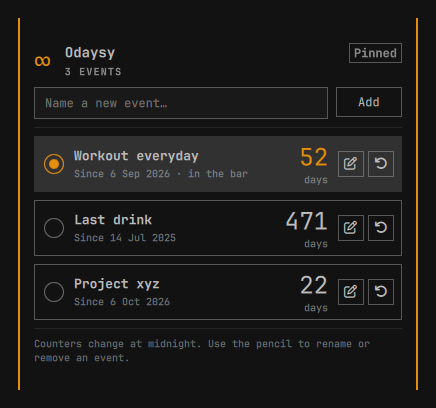

# Odaysy

Days-since counters for the Omarchy bar.

Track as many things as you like, and put one of the numbers in the bar. A
counter is stored as a timestamp, so it survives a reboot, a shell reload or a
holiday. Counters move at midnight, not 24 hours after the last time you
looked.



## Install

```bash
git clone https://github.com/h1st0ry3D/odaysy.git "$HOME/github/odaysy"

# Relative target, so the link survives a different username or home directory.
ln -sfn ../../../github/odaysy "$HOME/.config/omarchy/plugins/h1st0ry3d.odaysy"

omarchy-shell shell rescanPlugins
omarchy plugin enable h1st0ry3d.odaysy --section right
```

If `omarchy plugin enable` says the plugin is unknown, the rescan has not
finished yet; run it again. The bar entry can be moved like any other widget:

```bash
omarchy bar move h1st0ry3d.odaysy --section right
```

There is no build step and no dependency beyond the Python 3 that Omarchy
already ships. The plugin never talks to the network.

## Use

Click the number in the bar.

- **Add** puts the typed name in the list with a counter of 0 today. The first
  event added to an empty list is pinned automatically, so its radio is already
  selected and the bar starts showing it immediately.
- **Pencil** edits the name. The same row turns into **save**, **cancel** and
  **remove**.
- **Circle** pins one event to the bar. Clicking a selected circle unpins it.
- **Undo arrow** resets the counter to 0 after a confirmation.

The bar shows:

| Events | Bar |
|---|---|
| none | `∞` |
| one | that event's number |
| two or more | the pinned event's number, or `∞` when nothing is pinned |

Day values are local calendar days. An event added at 23:00 becomes 1 at
midnight.

## Config

The list lives in one file:

```
~/.config/odaysy/config.json
```

`$XDG_CONFIG_HOME/odaysy/config.json` is used instead when that variable is
set. The plugin creates the file on the first **Add**; it is not needed to
start.

```json
{
  "version": 1,
  "pinnedId": "0123456789abcdef",
  "events": [
    {
      "id": "0123456789abcdef",
      "title": "Quit smoking",
      "since": "2026-08-01T09:00:00.000Z"
    },
    {
      "id": "fedcba9876543210",
      "title": "Last drink",
      "since": "2026-09-14T18:30:00.000Z"
    }
  ]
}
```

- `since` is UTC in ISO 8601 form. The counter compares its local date with
  today's local date.
- `pinnedId` is one event id, or `""`. It is cleared when that event is
  removed.
- Names are capped at 120 characters and the list at 100 events.

The panel does not write this file itself. It calls the helper next to
`Panel.qml`, which is the only reader and writer. The helper refuses a symlink,
FIFO, device or file larger than 128 KiB, keeps the directory at `0700`, and
publishes changes through a mode-`0600` temporary followed by rename. A
hand-edited file is accepted on the next open as long as it matches the shape
above.

The helper can be run from a terminal for debugging or scripting:

```bash
python3 ~/.config/omarchy/plugins/h1st0ry3d.odaysy/odaysy_helper.py list
python3 ~/.config/omarchy/plugins/h1st0ry3d.odaysy/odaysy_helper.py add -- "Quit smoking"
python3 ~/.config/omarchy/plugins/h1st0ry3d.odaysy/odaysy_helper.py reset -- <id>
```

`list`, `add`, `rename`, `reset`, `pin`, `unpin` and `remove` print the whole
document as one JSON line. `path` prints the config path. Errors go to stderr
with a non-zero exit status.

## Tests

```bash
just test
# or
python3 -m unittest discover -s tests -v
node tests/test_model.js
```

The Python tests cover atomic writes, symlink refusal and the add/rename/pin/
reset/remove flow. The Node test covers the calendar maths and the bar's
empty, one-event and pinned cases.

## Uninstall

```bash
omarchy plugin remove h1st0ry3d.odaysy
```

That unlinks the plugin and disables it. Your counters are deliberately left
behind. Delete `~/.config/odaysy/config.json` and `~/.config/odaysy/.lock`,
then remove the empty `~/.config/odaysy` directory if you want them gone too.

## Licence

MIT. See [LICENSE](LICENSE).
